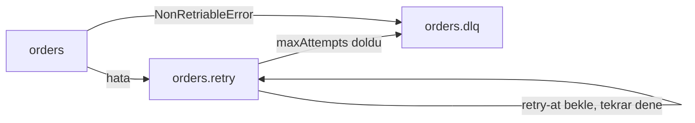

# 10 - Retry topic ve DLQ

## Konu
Handler hata verdiğinde üç seçeneğin var:

| Yaklaşım | Artı | Eksi |
|----------|------|------|
| **Bloklayan retry** (yerinde tekrar dene) | Sıralama korunur | Tek bir poison mesaj partition'ı durdurur |
| **Atla / logla** | Akış durmaz | Veri kaybı |
| **Retry topic + DLQ** (non-blocking) | Akış durmaz, kayıp yok | Aynı key için sıralama bozulabilir |

Non-blocking retry akışı:

- Retry mesajı header'larında deneme sayısını ve "en erken ne zaman denenebilir" bilgisini (`retry-at`) taşır.
- Retry consumer beklerken ana consumer'ı bloklamamalı; bu yüzden ayrı bir consumer (ayrı grup) kullanılır.
- Retry etmenin anlamı olmayan hatalar (şema/doğrulama) doğrudan DLQ'ya gider.
- DLQ mesajı teşhis için yeterli bilgi taşımalı: orijinal key/value, hata, deneme sayısı, kaynak topic.

## Görev (`exercise.ts`)
`startRetryPipeline`'ı `types.ts`'teki sözleşmeye göre yaz. Şu anki kod yerinde, beklemeden retry ediyor ve sonunda mesajı atıyor.

## Test senaryosu
Ana topic'e sırayla `ok-1, poison, ok-2, flaky, invalid, ok-3` yazılır. `maxAttempts: 3`, `retryDelayMs: 1000`.
- `ok-*` hemen işlenmeli
- `flaky` 3. denemede başarılı olmalı, denemeler arasında ≥1sn olmalı
- `poison` 3 denemeden sonra DLQ'ya
- `invalid` retry edilmeden DLQ'ya

## Düşün
- `retry-at`'i beklemek için retry consumer'da `sleep` kullanmak ne zaman sorun olur? (Farklı gecikmeler: `retry-5s`, `retry-1m` gibi ayrı topic'ler.)
- Aynı müşterinin `OrderCreated` mesajı retry'dayken `OrderCancelled` ana topic'te işlenirse ne olur? Sıralamanın kritik olduğu durumlarda ne yaparsın? (O key için sonraki mesajları da retry'a park et, ya da bloklayan retry.)
- DLQ'daki mesajları nasıl yeniden işlersin (redrive)?
