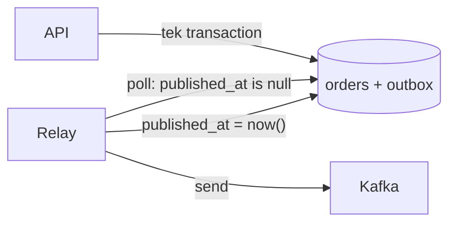

# 11 - Transactional outbox

## Konu: dual-write problemi
```ts
await db.insert(order);          // 1
await kafka.send(OrderCreated);  // 2
```
- 1 ile 2 arasında crash olursa sipariş var, olay yok: downstream (fatura, stok) siparişten habersiz kalır.
- Sırayı çevirirsen olay var, sipariş yok.
- DB ile Kafka arasında ortak bir transaction yok.

**Outbox deseni:** Olayı iş verisiyle **aynı DB transaction'ında** bir `outbox` tablosuna yaz. Ayrı bir **relay** süreci outbox'ı okuyup Kafka'ya yayınlar ve satırı işaretler.



Relay, yayınladıktan sonra ve işaretlemeden önce çökebilir. Bu yüzden outbox **at-least-once** çalışır: olay tekrar yayınlanır. Her olay sabit bir kimlik taşır (`message-id` = outbox satır id'si); consumer bu kimlikle dedup eder (07).

Alternatif: relay yerine CDC (Debezium) kullanmak. Postgres WAL'ını okur ve polling yapmaz.

## Görev (`exercise.ts`)
1. `createOrder`: Sipariş ve olay atomik yazılsın.
2. `startOutboxRelay`: Birden fazla relay instance'ı aynı anda çalışabilmeli:
   - Aynı olay iki relay tarafından yayınlanmamalı.
   - Aynı aggregate'in olayları outbox sırasıyla yayınlanmalı.
   - Crash sonrası kayıp olmamalı.

## İpuçları
- `withTransaction(pool, client => ...)` (`src/lib/db.ts`)
- `SELECT ... FOR UPDATE SKIP LOCKED` iki relay'in aynı satırları almasını engeller. Ama sıralamayı korur mu? Relay A 1-2 numaralı satırları, relay B 3-4 numaralı satırları alıp aynı anda gönderirse ne olur?
- `pg_try_advisory_xact_lock(key)`: transaction süresince geçerli, bloklamayan global kilit.

## Düşün
- Tek aktif relay throughput'u sınırlar. Aggregate bazında paralelleştirmek için ne yaparsın? (`hash(aggregate_id) % N` ile relay başına bir dilim.)
- Outbox tablosu büyür. Yayınlanmış satırları ne zaman silersin?
- Polling gecikmesi ile DB yükü arasındaki dengeyi nasıl kurarsın? (`LISTEN/NOTIFY`, CDC)
